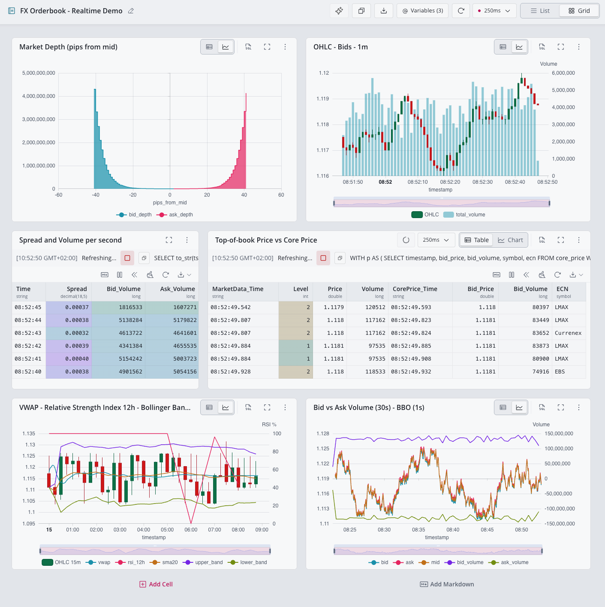
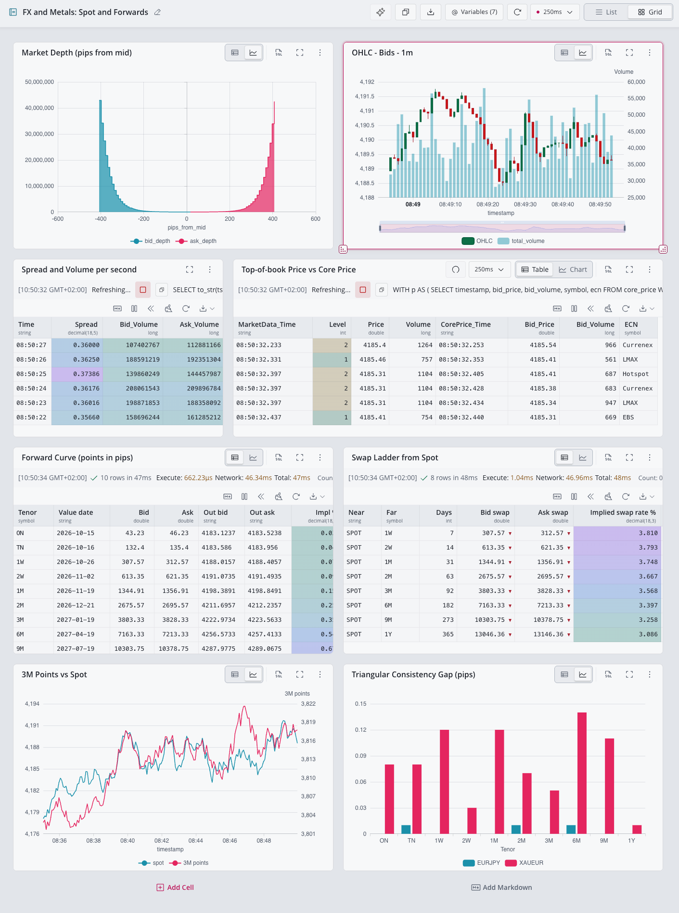

# FX Synthetic Data Generator & Ingestor for QuestDB

This script generates highly realistic, multi-level FX market data and ingests it into QuestDB at high speed. It produces three interconnected datasets:

1. **`market_data`** - Full depth orderbook snapshots (L2 market data)
2. **`core_price`** - Best bid/offer (BBO) with indicators and metadata
3. **`fx_trades`** - Executed trades with realistic order matching against orderbooks

Two optional layers, both off by default: `--metals true` adds the precious metals pairs
(XAUUSD, XAGUSD, XPTUSD, XPDUSD, XAUEUR) to the universe, and `--forwards true` adds a fourth
table, **`fx_forward_points`**, with forward point ladders for forwards and swaps. See
[Precious metals](#precious-metals) and [Forwards and swaps](#forwards-and-swaps). The
Java sibling supports both with the same flags, so a Java backfill can be continued by
Python real-time with either layer on (run both engines with the same flags).

Designed for **stress testing**, **benchmarking**, and **live demo scenarios**, it supports both wall-clock-paced ("real-time") and maximum-throughput ("faster-than-life") simulation with multi-process orchestration, pip-accurate pricing, WAL backpressure detection, and robust state management.

> **Java sibling (QWP):** [`java-qwp/`](java-qwp/README.md) is a Java generator that ingests the **same tables (including `fx_forward_points` with `--forwards true`) and the same materialized views** over QuestDB's QWP (WebSocket) protocol. This Python generator is authoritative; the two are **dataset-compatible**: run the Java one with `--prefix none` and matching EPS flags and you can backfill with one and continue (or go live) with the other on the same tables. See its README for the interchangeability runbook.

---

## Features

### Data Generation

- **Three-Table Architecture, plus optional forwards:**
  - **`market_data`**: Multi-level orderbook snapshots (bids/asks at 3-50 levels) at 1,200-15,000 events/sec
  - **`core_price`**: Best bid/offer snapshots with ECN, reason codes, and technical indicators at 700-1,000 events/sec
  - **`fx_trades`**: Realistic trade executions (5-30 orders/sec) with partial fills, level walking, and counterparty LEIs
  - **`fx_forward_points`** (with `--forwards true`): forward point ladders, 10 tenors per pair every 5 seconds (16 rows/sec for the 8 FX pairs, 26 with `--metals true`)

- **Realistic Order Execution:**
  - Orders execute against actual orderbook liquidity
  - Supports passive (limit) and aggressive (market) orders
  - Orders can walk multiple levels until filled or limit price reached
  - Each order generates 1-N trades with consistent `order_id`
  - ECN consistency: all trades from same order execute on same ECN

- **30 FX Pairs with Liquidity Ranking:**
  - Major pairs (EURUSD, USDJPY, GBPUSD) have higher trade frequency
  - Exotic pairs trade less frequently based on realistic liquidity distribution
  - Pip-accurate pricing for each pair (0.0001 for majors, 0.01 for JPY crosses)

- **Deterministic Counterparty Pool:**
  - Generates realistic 20-character LEIs (Legal Entity Identifiers)
  - Hash-based generation ensures expandability (first N LEIs always identical)
  - Configurable pool size (default: 2000)

- **Live Market Data Integration (Real-time Mode):**
  - Yahoo Finance updates price brackets every 5 minutes
  - Keeps simulation aligned with current market conditions
  - Prevents unrealistic price drift

- **Temporal Consistency:**
  - Intra-second price interpolation for smooth OHLC bars
  - `close(second N)` always equals `open(second N+1)`
  - Trades timestamped after their source orderbook snapshot (ASOF join compatible)
  - All tables flush together for dashboard consistency (`fx_forward_points` flushes with `core_price`)

### Performance & Reliability

- **Parallel High-Throughput Ingestion:**
  - Multiprocessing splits event generation across workers
  - Each process handles unique time partitions (no overlap)
  - Typical: 8-11K events/sec sustained on 6-8 cores

- **WAL Lag Detection and Flow Control:**
  - Dedicated monitor process queries QuestDB's WAL progress
  - Workers pause when lag exceeds threshold, resume when cleared
  - Prevents QuestDB memory pressure during fast ingestion

- **Resumable, Incremental Ingestion:**
  - Automatically detects latest timestamp in database
  - Advances start time to avoid overlap
  - Supports continuous/incremental data generation

- **Materialized Views Auto-Setup:**
  - Creates 11 views: OHLC and BBO at 1s to 1d granularities for `core_price`, `market_data` and `fx_trades`
  - Plus `fx_forward_points_1m` with `--forwards true` (12 views); see [Materialized Views](#materialized-views)
  - Optional TTLs for demo environments

---

## Tables & Schema

### `market_data`
Full orderbook depth with array storage for efficient ingestion:
```sql
timestamp TIMESTAMP
symbol SYMBOL
bids DOUBLE[][]  -- bids[0] = prices, bids[1] = volumes
asks DOUBLE[][]  -- asks[0] = prices, asks[1] = volumes
best_bid DOUBLE  -- materialized bids[1][1] for fast queries
best_ask DOUBLE  -- materialized asks[1][1] for fast queries
```
**Volume:** 1,200-15,000 events/second

### `core_price`
Best bid/offer snapshots with metadata:
```sql
timestamp TIMESTAMP
symbol SYMBOL
ecn SYMBOL  -- LMAX, EBS, Hotspot, Currenex
bid_price DOUBLE
bid_volume LONG
ask_price DOUBLE
ask_volume LONG
reason SYMBOL  -- normal, news_event, liquidity_event
indicator1 DOUBLE
indicator2 DOUBLE
```
**Volume:** 700-1,000 events/second

### `fx_trades`
Executed trades with nanosecond precision:
```sql
timestamp TIMESTAMP_NS  -- Nanosecond precision
symbol SYMBOL
ecn SYMBOL
trade_id UUID
side SYMBOL  -- buy, sell
passive BOOLEAN
price DOUBLE
quantity DOUBLE
counterparty SYMBOL  -- 20-char LEI
order_id UUID  -- Multiple trades can share same order_id (partial fills)
```
**Volume:** 5-30 orders/second → typically 5-50 trades/second (depending on partial fills)

### `fx_forward_points` (with `--forwards true`)
Forward point ladders, one row per pair and tenor:
```sql
timestamp TIMESTAMP
symbol SYMBOL
tenor SYMBOL       -- ON, TN, 1W, 2W, 1M, 2M, 3M, 6M, 9M, 1Y
tenor_days INT     -- calendar days from spot to the value date (negative for ON and TN)
value_date TIMESTAMP  -- midnight UTC of the settlement date
bid_points DOUBLE  -- in pips, can be negative
ask_points DOUBLE
spot_ref DOUBLE    -- the spot mid the ladder was priced on
source SYMBOL      -- FWD_FEED
```
`DEDUP UPSERT KEYS(timestamp, symbol, tenor)`, partitioned and retained like `core_price`.
**Volume:** 26 rows/second with `--metals` (13 pairs x 10 tenors every 5 seconds, about
2.2M rows a day), 16 rows/second without.

---

## Arguments

| Argument                     | Type      | Default       | Description                                                                                    |
|------------------------------|-----------|---------------|------------------------------------------------------------------------------------------------|
| `--host`                     | str       | `127.0.0.1`   | Host/IP of QuestDB. For QWP, a comma-separated `host:port` list enables multi-host HA failover (a bare host gets `:9000`). DDL/metadata use the **first** entry, so list the writable primary first; the QWP WAL monitor reads from whichever node is primary |
| `--pg_port`                  | str/int   | `8812`        | PostgreSQL port for QuestDB metadata queries                                                   |
| `--user`                     | str       | `admin`       | Database user for metadata                                                                     |
| `--password`                 | str       | `quest`       | Password for metadata                                                                          |
| `--token`                    | str       | None          | Authentication token: bearer token for HTTP/HTTPS and QWP, JWK private key `d` for TCPS        |
| `--token_file`               | str       | None          | Read the token from this file (trimmed); overrides `--token`, keeps it off the command line    |
| `--token_x`                  | str       | None          | JWK token X coordinate (for tcps)                                                              |
| `--token_y`                  | str       | None          | JWK token Y coordinate (for tcps)                                                              |
| `--ilp_user`                 | str       | `admin`       | ILP/HTTP ingestion user                                                                        |
| `--protocol`                 | str       | `qwp`         | `qwp` (QWP/WebSocket on port 9000), `http` or `tcp`. `tcps`/`https` used automatically if a token is present; QWP uses `--qwp_tls` for TLS |
| `--qwp_tls`                  | bool      | `false`       | QWP only: use `wss` (TLS) instead of `ws`, with `tls_verify=unsafe_off`                        |
| `--durable_ack`              | bool      | `false`       | QWP only: `request_durable_ack=on` so a failover cannot lose acked-but-unreplicated rows (Enterprise) |
| `--store_forward_dir`        | str       | `<tmp>/fx_qwp_sf` | QWP only: base dir for per-worker store-and-forward spill (each worker gets an `fx-<idx>` subdir) |
| `--mode`                     | str       | **Required**  | `real-time` (wall clock) or `faster-than-life` (max speed)                                     |
| `--market_data_min_eps`      | int       | `1200`        | Min `market_data` events/sec (must be > `core_max_eps`)                                        |
| `--market_data_max_eps`      | int       | `15000`       | Max `market_data` events/sec                                                                   |
| `--core_min_eps`             | int       | `700`         | Min `core_price` events/sec (must be > `orders_max_per_sec`)                                   |
| `--core_max_eps`             | int       | `1000`        | Max `core_price` events/sec (must be < `market_data_min_eps`)                                  |
| `--orders_min_per_sec`       | int       | `5`           | Min orders/sec (each order → 1-N trades, must be < `core_min_eps`)                             |
| `--orders_max_per_sec`       | int       | `30`          | Max orders/sec                                                                                 |
| `--lei_pool_size`            | int       | `2000`        | Number of unique counterparty LEIs to generate                                                 |
| `--total_market_data_events` | int       | `1_000_000`   | Total `market_data` events to generate (faster-than-life mode only)                            |
| `--start_ts`                 | str       | now (UTC)     | Simulation start time (ISO8601). Not allowed in real-time mode                                 |
| `--end_ts`                   | str       | None          | Simulation end time (ISO8601)                                                                  |
| `--chunk_seconds`            | int       | `900`         | Max seconds to precompute per chunk in faster-than-life mode (limits memory usage)             |
| `--processes`                | int       | `1`           | Number of worker processes (real-time allows only 1)                                           |
| `--market_data_processes`    | int       | None          | Toggle for `market_data` (parity shim for the Java per-pool flag). `0` = disable (send only `core_price` + `fx_trades`, e.g. fast two-table demos); `1` = enable (default). Other values are rejected. When `0`, the stop budget (`--total_market_data_events`) counts `core_price` events, and the flush buffer + WAL lag threshold auto-scale to core_price's rate |
| `--wal_lag_threshold`        | int       | auto          | Pause ingestion when the monitored table's WAL apply lag exceeds this many transactions. Default: `3*processes` with `market_data` on; ~10s of `core_price`'s commit rate (≈100 at high core EPS) when disabled |
| `--realtime_slice_ms`        | int       | `0`           | Real-time only: split each second into slices of this many ms and flush after each, so rows arrive smoothly instead of one burst/sec (e.g. `100` = 10 evenly-spaced flushes/sec). `0` = off. Continuity is preserved (slice states interpolate on the open→close line). Ignored in faster-than-life. (Java equivalent: `--commit_interval_ms`) |
| `--min_levels`               | int       | `40`          | Min orderbook levels                                                                           |
| `--max_levels`               | int       | `40`          | Max orderbook levels                                                                           |
| `--incremental`              | bool      | `false`       | Load last state from DB to continue appending (faster-than-life only)                          |
| `--create_views`             | bool      | `true`        | Create materialized views if not present                                                       |
| `--short_ttl`                | bool      | `false`       | Enforce retention on all tables and views: `TTL 3 DAYS` on `market_data`, `core_price` and `fx_forward_points`, `TTL 1 MONTH` on `fx_trades`, 4 hours to 1 month on the views |
| `--enterprise`               | bool      | `false`       | With `--short_ttl`: QuestDB Enterprise storage policy (`TO REMOTE`, `TO PARQUET`, `DROP LOCAL`) on the tables instead of a TTL. Views always use a TTL |
| `--suffix`                   | str       | `""`          | Suffix to append to all table/view names                                                       |
| `--yahoo_refresh_secs`       | int       | `300`         | Yahoo Finance bracket refresh interval (real-time mode only)                                   |
| `--metals`                   | bool      | `false`       | Add XAUUSD, XAGUSD, XPTUSD, XPDUSD and XAUEUR to the pair universe. Total EPS is unchanged, so each FX pair gets 30/35 of its usual rows. See [Precious metals](#precious-metals) |
| `--forwards`                 | bool      | `false`       | Create and fill `fx_forward_points` (and `fx_forward_points_1m` with `--create_views`). See [Forwards and swaps](#forwards-and-swaps) |
| `--bad_point_utc`            | str       | `09:20`       | `--forwards` only: UTC start (`HH:MM`) of the daily 20-minute planted bad forward point        |
| `--seed`                     | int       | None          | Seed every random stream so faster-than-life runs are reproducible byte for byte (Yahoo brackets aside). Unset = unseeded, as before |

### Event Rate Validation

The script enforces a hierarchy to maintain realism:
- `market_data_min_eps` > `core_max_eps` (orderbooks update faster than BBO snapshots)
- `core_min_eps` > `orders_max_per_sec` (more price updates than trades)

Violating these constraints will cause the script to exit with an error message. When
`market_data` is disabled (`--market_data_processes 0`), the first check is skipped so
demos can push `core_price` EPS as high as they like.

---

## Ingestion Modes

### Real-Time Mode (`--mode real-time`)

- Generates data at wall-clock pace (1 simulated second = 1 real second)
- Timestamps are always 2 seconds ahead of wall clock for dashboard responsiveness
- Yahoo Finance refreshes price brackets every 5 minutes (configurable)
- Single process only (`--processes 1`)
- Runs indefinitely until stopped or `--total_market_data_events` reached
- Always starts from now: `--start_ts` is rejected with an error

**Use cases:** Live demos, continuous data streams, dashboard testing

### Faster-Than-Life Mode (`--mode faster-than-life`)

- Generates data as fast as possible (no wall-clock pacing)
- Processes in chunks (default 15 min) to limit memory usage for long runs
- Maintains OHLC continuity across chunk boundaries
- Supports multiprocessing for parallel ingestion
- Stops at `--total_market_data_events` (default 1,000,000) or `--end_ts`, whichever comes first
- Can use `--start_ts` and `--end_ts` for specific time ranges
- Yahoo Finance queried once at startup (or bypassed if `--incremental`)

**Use cases:** Backfills, stress testing, benchmarking, generating historical datasets

---

## Usage Examples

### Real-Time Streaming (Live Demo)

```bash
python fx_data_generator.py \
  --host 172.31.42.41 \
  --market_data_min_eps 1200 \
  --market_data_max_eps 2500 \
  --core_min_eps 700 \
  --core_max_eps 1000 \
  --orders_min_per_sec 5 \
  --orders_max_per_sec 30 \
  --lei_pool_size 2000 \
  --token "your_token_here" \
  --token_x "your_token_x_here" \
  --token_y "your_token_y_here" \
  --ilp_user ilp_ingest \
  --protocol tcp \
  --mode real-time \
  --processes 1 \
  --total_market_data_events 800_000_000
```

### High-Speed Batch Backfill (14 hours of data)

```bash
python fx_data_generator.py \
  --host 172.31.42.41 \
  --market_data_min_eps 8200 \
  --market_data_max_eps 11000 \
  --core_min_eps 700 \
  --core_max_eps 1000 \
  --orders_min_per_sec 5 \
  --orders_max_per_sec 30 \
  --lei_pool_size 2000 \
  --token "your_token_here" \
  --token_x "your_token_x_here" \
  --token_y "your_token_y_here" \
  --ilp_user ilp_ingest \
  --protocol tcp \
  --mode faster-than-life \
  --processes 6 \
  --total_market_data_events 600_000_000 \
  --start_ts "2025-11-11T00:00:00.000000Z" \
  --end_ts "2025-11-11T14:00:00.000000Z" \
  --min_levels 3 \
  --max_levels 3 \
  --incremental false
```

### Local Development (No Authentication)

```bash
python fx_data_generator.py \
  --host 127.0.0.1 \
  --market_data_min_eps 110 \
  --market_data_max_eps 150 \
  --core_min_eps 70 \
  --core_max_eps 100 \
  --orders_min_per_sec 5 \
  --orders_max_per_sec 30 \
  --protocol tcp \
  --mode real-time \
  --processes 1 \
  --total_market_data_events 100_000_000 \
  --lei_pool_size 2000
```

### QWP/WebSocket ingestion (multi-host HA)

QWP rides the same port `9000`. Pass a comma-separated `host:port` `--host` for automatic
failover across nodes. Each worker ingests through the client's connection pool
(`questdb.connect()`), which follows the writable primary and replays the worker's
store-and-forward spool on disk (`--store_forward_dir`) after reconnecting, so there is no
need to re-point the generator when a replica is promoted. Rows go through `row()`, not
dataframes, because QWP dataframe loads bypass store-and-forward. The in-flight frame window
is raised to 4096 so a primary outage of a few minutes is queued instead of failing.
The WAL monitor reads `wal_tables()` over QWP with `target=primary`, so it also follows the
primary, and waits up to 5 minutes for a new one. `--durable_ack true` guards against losing
acked-but-unreplicated rows across a failover (Enterprise).

DDL, the latest-timestamp check and `--incremental` state loading still use PG-wire (port
`8812`) on the **first** host, at startup only, so list the primary first.

```bash
python fx_data_generator.py \
  --protocol qwp \
  --host node1:9000,node2:9000,node3:9000 \
  --qwp_tls true --token_file "$HOME/qwp_token.txt" --durable_ack true \
  --mode real-time \
  --market_data_min_eps 1200 --market_data_max_eps 2500 \
  --core_min_eps 700 --core_max_eps 1000 \
  --orders_min_per_sec 5 --orders_max_per_sec 30 \
  --min_levels 40 --max_levels 40 \
  --processes 1 --total_market_data_events 800_000_000
```

### Two-table demo (disable `market_data`)

For a fast-ingest demo into just `core_price` + `fx_trades`, pass
`--market_data_processes 0`. The `market_data` table and its `bbo_*` / `market_data_ohlc_*`
views are not created, and the stop budget (`--total_market_data_events`) counts
`core_price` events. Core EPS can be pushed high (the market > core check is skipped).

```bash
python fx_data_generator.py \
  --protocol qwp --host 127.0.0.1 \
  --market_data_processes 0 \
  --core_min_eps 2000 --core_max_eps 4000 \
  --orders_min_per_sec 5 --orders_max_per_sec 30 \
  --mode real-time --processes 1 --total_market_data_events 100_000_000
```

### Runner scripts

| Script | What it runs |
|---|---|
| `fx_real_time_ingest.sh` | Real-time over TCP/ILP, local |
| `fx_backfill_ingest.sh` | Faster-than-life backfill over TCP/ILP |
| `fx_qwp_real_time.sh` | Real-time over QWP, multi-host HA, token file, durable acks |
| `fx_qwp_backfill.sh` | Faster-than-life backfill over QWP with the same connection settings; run `fx_qwp_real_time.sh` afterwards to continue live on the same tables |

Each script has an `EXTRA_ARGS` block with `--metals true` and `--forwards true` commented out.
Uncomment to enable. The first run with `--forwards true` needs `--create_views true` so
`fx_forward_points_1m` exists (the scripts default to `--create_views false`).

---

## Precious metals

`--metals true` adds five pairs to the universe: **XAUUSD**, **XAGUSD**, **XPTUSD**,
**XPDUSD** and **XAUEUR**. Precious metals trade as FX pairs: the metal is the base currency
(always `XAUUSD`, never `USDXAU`), quoted in USD or EUR per troy ounce, two-way, T+2 spot. They
flow through `market_data`, `core_price`, `fx_trades` and every view like any other pair, so
the spot presentation (candles, views, `ASOF JOIN`, `HORIZON JOIN` markouts) runs unchanged
with a metal selected.

| Pair | Pip | Decimals | Yahoo | Spread (pips) | Book level step | Notes |
|---|---|---|---|---|---|---|
| XAUUSD | 0.01 | 2 | `GC=F` | 20 to 40 ($0.20 to $0.40) | 10 pips, 40 levels span $4 | the metals benchmark |
| XAGUSD | 0.001 | 3 | `SI=F` | 20 to 40 ($0.02 to $0.04) | 5 pips | |
| XPTUSD | 0.01 | 2 | `PL=F` | 100 to 300 | 20 pips | |
| XPDUSD | 0.01 | 2 | `PA=F` | 300 to 800 | 50 pips | widest and jumpiest |
| XAUEUR | 0.01 | 2 | derived: XAUUSD / EURUSD | 25 to 50 | 10 pips | |

- **Sizes are troy ounces.** The generator's size fields are notional in base units, so the
  same log-normal shapes are rescaled per metal: gold orders have a median around 3,000 oz,
  silver around 50,000 oz, and order book levels scale the same way.
- **Prices** walk at roughly twice the real per-second volatility, quantised to the pip like
  every FX pair. The `XAUUSD=X` style spot tickers do not resolve on Yahoo, so brackets come
  from the front-month futures (a small premium to spot) with dated static fallbacks in
  `METALS_PAIRS`.
- **Dilution.** Total EPS is unchanged, so with `--metals` each of the 30 FX pairs gets 30/35
  of its usual rows. The FX pairs' price paths do not change (metals draw from their own
  random stream), only the row counts fall in proportion.

## Forwards and swaps

`--forwards true` (both modes) creates `fx_forward_points` and, with `--create_views true`,
the 1-minute view `fx_forward_points_1m`, both through the same retention, suffix and
Parquet-encoding helpers as `core_price` (`TTL 3 DAYS` or the Enterprise storage policy on
the table, `TTL 2 DAYS` on the view with `--short_ttl`). The view keeps 2 days rather than
`core_price_1s`'s 4 hours so the daily planted event is still there for an afternoon demo.

**Covered pairs:** the majors EURUSD, USDJPY, GBPUSD, USDCHF, AUDUSD, USDCAD, NZDUSD, plus
EURJPY; with `--metals` also XAUUSD, XAGUSD, XPTUSD, XPDUSD and XAUEUR. **Tenors:** ON, TN, 1W,
2W, 1M, 2M, 3M, 6M, 9M, 1Y.

**Model.** Points come from covered interest parity,
`points = spot x ((1 + r_quote x d / basis) / (1 + r_base x d / basis) - 1) / pip`, on
per-currency short-rate curves (lease-rate curves for the metals, so XAUUSD shows contango
and the platinum and short-dated silver curves show backwardation). The curves are static
tables in the file (`RATE_CURVES`, dated, with sources) plus a slow random walk: a parallel
shift of a few basis points a day and small per-tenor noise. Day count: Act/365 for GBP,
Act/360 for every other currency and for lease rates. Spot is the generator's own mid at the
emission instant, so outrights are consistent with `core_price`; each row records it as
`spot_ref`. Crosses (EURJPY, XAUEUR) are derived from their legs, so the triangular check holds
by construction. Bid and ask are the mid plus or minus a half spread that widens with tenor.

**Value dates.** Spot is T+2 business days for every pair (weekday calendar, no holidays;
USDCAD is T+1 in the real market). Tenors roll from spot, whole months with the end-of-month
rule and modified following. ON and TN follow market convention: they carry the points of the
short swaps today to tomorrow and tomorrow to spot, their value dates are today and tomorrow
and `tenor_days` is negative, so their outrights are spot **minus** the cumulative points.
`value_date` is recomputed at each emission and rolls at midnight UTC; on a weekend the trade
date rolls to Monday.

**Cadence.** One full ladder per pair every 5 seconds, each pair at its own phase plus jitter,
the same simulated cadence in both modes. In faster-than-life one worker emits all ladders.
Forward randomness has its own stream, so spot data is identical with the flag on or off.

**Planted event.** Once per simulated day, from `--bad_point_utc` (default **09:20 UTC**) for
20 minutes, the EURJPY 3M mid (XAUEUR 3M with `--metals`) is published 6 pips away from what
its legs imply. `source` stays `FWD_FEED`: it is a feed error, not a manual mark. Nothing else
in the data competes with it. The run prints its timestamps at the end, as `@bad_point_from`
and `@bad_point_to` values. In real-time mode, a generator started after 09:40 UTC on a day
with no backfill has no event that day, so backfill the day first (`fx_qwp_backfill.sh` or
`fx_backfill_ingest.sh` with `--forwards true`).

**Queries.** The forwards section of `demo_queries.sql` has six cells: the forward curve now
with outrights, the same curve as of any instant, implied carry and lease rates, swap points
between two tenors, the triangular consistency check (which returns the planted window), and
the points history against spot.

**Volume.** 26 rows/second with `--metals` (about 2.2M rows a day), against 700 to 1,000 for
`core_price` and 1,200 to 15,000 for `market_data`: about 3% of `core_price`, and narrow
rows. The 1-minute view holds 13 x 10 x 1,440 = about 190k rows a day. The WAL monitor keeps
watching `market_data` (or `core_price`) as before.

## Demo dashboards

Two dashboards, each available as a native QuestDB Web Console notebook and as a Grafana
dashboard:

- **FX Orderbook - Realtime Demo**: spot only, with both flags off.
- **FX and Metals: Spot and Forwards**: spot plus forwards and swaps, with
  `--metals true --forwards true` and XAUUSD selected. It needs `market_data` and its views, so
  it is not for two-table mode (`--market_data_processes 0`).

### QuestDB Web Console (no Grafana needed)

Native QuestDB dashboards, built as Web Console notebooks. They need **QuestDB 10.0 or later,
or QuestDB Enterprise 4.0 or later**. To install, open the **⋮** menu at the right end of the
Web Console tab bar, choose **Import tabs**, and import each file:

- `questdb-fx-orderbook-realtime-demo-dashboard.json`: FX Orderbook - Realtime Demo
- `questdb-fx-and-metals-spots-and-forwards-dashboard.json`: FX and Metals: Spot and Forwards

Each one opens as a new notebook tab, already in the grid layout. The tables and views each one
needs are listed in the setup section of
[docs/questdb-console-dashboards.md](docs/questdb-console-dashboards.md).

They use notebook variables instead of a pair selector and time picker: `@symbol` (EURUSD and
XAUUSD by default) and `@asof` (`now()`). Change `@symbol` to switch pairs, or set `@asof` to a
past instant (for example inside 09:20 to 09:40 UTC) to replay it and see the planted bad point
in the consistency cell. They refresh every 250 ms by default; some cells use a slower refresh of
their own. Each cell's window, logic, formatting and the differences from Grafana are documented
in [docs/questdb-console-dashboards.md](docs/questdb-console-dashboards.md).





### Grafana

- `grafana_dashboard.json`: FX Orderbook - Realtime Demo.
- `fx_forwards_grafana_dashboard.json`: FX and Metals: Spot and Forwards. It reuses the first
  dashboard's Market Depth, top-of-book and 1-minute OHLC panels unchanged (and its 250 ms
  refresh), so spot looks and ticks the same; then a Forwards row (the curve with outrights and
  implied rates; every 3M ladder of the last 15 minutes against the spot it was priced on; the
  triangular consistency gap per tenor) and a Swaps row (the swap ladder from spot with implied
  swap rates and far-leg outrights). The consistency panel reads the latest complete minute of
  the selected time range: set the range to end inside 09:20 to 09:40 UTC to see the planted
  bad point turn a bar red.

Both are exported with the datasource as an input: pick your QuestDB datasource on import.
They need the QuestDB datasource plugin and, for Market Depth, the Plotly panel plugin.

Pick the pair in the symbol dropdown at the top: it lists every pair with `core_price` data in
the last 4 days (metals included). The first dashboard accepts several pairs and repeats its
panels per pair; the second takes one, XAUUSD by default. The time picker defaults to the last
6 hours, but most panels override it with their own short window ending now (10 minutes for
depth, 1 minute for top of book and candles, 15 minutes for 3M points, today for the
indicators). The forward curve, swap ladder and consistency panel follow the picker's end time.
Refresh is 250 ms. Each panel's window, query and display are documented in
[docs/grafana-dashboards.md](docs/grafana-dashboards.md).


---

## Docker Support

Build and run via Docker:

```bash
docker build -t fx-generator .

docker run -e HOST=172.31.42.41 \
           -e MARKET_DATA_MIN_EPS=1200 \
           -e MARKET_DATA_MAX_EPS=2500 \
           -e CORE_MIN_EPS=700 \
           -e CORE_MAX_EPS=1000 \
           -e ORDERS_MIN_PER_SEC=5 \
           -e ORDERS_MAX_PER_SEC=30 \
           -e LEI_POOL_SIZE=2000 \
           -e METALS=true \
           -e FORWARDS=true \
           fx-generator
```

For TCP with JWK authentication instead, add `-e PROTOCOL=tcp -e TOKEN=... -e TOKEN_X=...
-e TOKEN_Y=... -e ILP_USER=...`.

The entrypoint maps these environment variables to arguments. Image defaults:

| Variable | Argument | Default |
|---|---|---|
| `MODE` | `--mode` | `real-time` |
| `SHORT_TTL` | `--short_ttl` | `True` |
| `ENTERPRISE` | `--enterprise` | `False` |
| `MARKET_DATA_MIN_EPS` / `MARKET_DATA_MAX_EPS` | `--market_data_min_eps` / `--market_data_max_eps` | `1200` / `2500` |
| `CORE_MIN_EPS` / `CORE_MAX_EPS` | `--core_min_eps` / `--core_max_eps` | `700` / `1000` |
| `TOTAL_MARKET_DATA_EVENTS` | `--total_market_data_events` | `25_000_000` |
| `PROTOCOL` | `--protocol` | `qwp` |
| `HOST` | `--host` | `host.docker.internal` |
| `PG_USER` / `PG_PASSWORD` / `PG_PORT` | `--user` / `--password` / `--pg_port` | `admin` / `quest` / `8812` |
| `TOKEN` / `TOKEN_X` / `TOKEN_Y` | `--token` / `--token_x` / `--token_y` | empty |
| `ILP_USER` | `--ilp_user` | `admin` |
| `YAHOO_REFRESH_SECS` | `--yahoo_refresh_secs` | `30` |
| `ORDERS_MIN_PER_SEC` / `ORDERS_MAX_PER_SEC` | `--orders_min_per_sec` / `--orders_max_per_sec` | `5` / `30` |
| `LEI_POOL_SIZE` | `--lei_pool_size` | `2000` |
| `METALS` | `--metals` | `false` |
| `FORWARDS` | `--forwards` | `false` |

Any other argument (for example `--suffix` or `--realtime_slice_ms`) can be appended after
the image name; it is passed through to the script. Views are created by default, so
`FORWARDS=true` also creates `fx_forward_points_1m`.

The image ingests over QWP (port 9000) by default. Open-source QuestDB needs no credentials
for QWP; `PG_USER` / `PG_PASSWORD` (admin / quest) are only used for the PG-wire connection
that creates tables and views at startup. For an authenticated server, pass `TOKEN`. The
store-and-forward spill directory is inside the container (`/tmp/fx_qwp_sf`), so it covers
QuestDB restarts and failovers, but not a restart of the container itself. For TCP or HTTP,
set `PROTOCOL=tcp` or `PROTOCOL=http`.

---

## Materialized Views

With `--create_views true` (the default) the script creates these views if they do not exist
(`CREATE ... IF NOT EXISTS`; to redefine one, drop it first). Names take `--suffix` like the
tables. The `bbo_*` and `market_data_ohlc_*` views are skipped in two-table mode
(`--market_data_processes 0`).

| View | Source | Refresh | Content | TTL with `--short_ttl` |
|---|---|---|---|---|
| `core_price_1s` | `core_price` | immediate | 1s OHLC of the mid, last spread, bid/ask min, max and avg | 4 hours |
| `core_price_1d` | `core_price` | every 1h | the same at 1 day | 1 month |
| `bbo_1s` | `market_data` | immediate | 1s last best bid and best ask | 3 days |
| `bbo_1m` | `bbo_1s` | every 1m | 1m max bid and min ask | 3 days |
| `bbo_1h` | `bbo_1m` | every 10m | 1h max bid and min ask | 1 month |
| `bbo_1d` | `bbo_1h` | every 1h | 1d max bid and min ask | 1 month |
| `market_data_ohlc_1m` | `market_data` | immediate | 1m OHLC of `best_bid`, plus summed level-1 bid size as `total_volume` | 1 day |
| `market_data_ohlc_15m` | `market_data_ohlc_1m` | immediate | 15m OHLC rolled up from the 1m view | 2 days |
| `market_data_ohlc_1d` | `market_data` | every 1h | 1d OHLC of `best_bid` plus `total_volume` | 1 month |
| `fx_trades_ohlc_1m` | `fx_trades` | immediate | 1m OHLC of traded `price`, plus summed `quantity` | 2 days |
| `fx_trades_ohlc_1d` | `fx_trades_ohlc_1m` | every 1h | 1d OHLC rolled up from the 1m view | 1 month |
| `fx_forward_points_1m` | `fx_forward_points` | immediate | only with `--forwards true`: last bid/ask points, `spot_ref`, value date and `tenor_days` per symbol, tenor and minute | 2 days |

Views refreshed on a timer are created `DEFERRED`, so they fill on their first scheduled
refresh. Without `--short_ttl` no view has a TTL. Views always use a TTL, even with
`--enterprise`, because materialized views do not accept a storage policy.

---

## Data Characteristics

### Realism Features

1. **Price Continuity:**
   - `close(second N)` = `open(second N+1)` for every symbol
   - Intra-second interpolation produces realistic candlesticks (not flat lines)
   - Controlled random walk with shock events (±20 pips occasionally)

2. **Spread Dynamics:**
   - Spreads evolve realistically (1-8 pips for majors)
   - Rare stress-widening events (0.05% probability)
   - Spread measured in pips to avoid floating-point artifacts

3. **Volume Distribution:**
   - Log-scaled volume ladder: thinner at best levels, deeper at worse levels
   - Best bid/ask: 50K-100K typical
   - Deep levels: 500M-1B liquidity

4. **Trade Execution:**
   - 40% passive orders (limit), 60% aggressive (market)
   - Passive: 0-2 pips slippage, aggressive: 3-10 pips slippage
   - Orders walk multiple levels if size exceeds liquidity
   - Log-normal trade size distribution (many small, few large)

5. **ECN Distribution:**
   - 4 ECNs: LMAX, EBS, Hotspot, Currenex
   - Random but consistent per order (all trades from order at same ECN)

6. **Liquidity Ranking:**
   - Top 9 pairs (EURUSD, USDJPY, GBPUSD, etc.) trade 10x more than exotics
   - Rank-weighted selection for realistic market share

### Timestamp Precision

- **market_data**: Microsecond (TIMESTAMP)
- **core_price**: Microsecond (TIMESTAMP)
- **fx_trades**: Nanosecond (TIMESTAMP_NS)
- **fx_forward_points**: Microsecond (TIMESTAMP), including `value_date`

Trade timestamps are always ≥1 microsecond after their source `core_price` event, ensuring ASOF joins work correctly despite precision differences.

---

## WAL Backpressure Control

- **Monitored table:** `market_data`, or `core_price` when `market_data` is disabled
- **Pause Threshold:** `sequencerTxn - writerTxn > --wal_lag_threshold` (default
  `3 * processes`, or about 10 seconds of `core_price` commits when `market_data` is disabled)
- **Resume:** Only when lag clears completely (`sequencerTxn == writerTxn`)
- The monitor prints a message when it pauses and resumes ingestion
- **Connection:** PG-wire to the first `--host` for HTTP and TCP; over QWP it reads from the
  primary through the client pool and follows a failover (see
  [QWP/WebSocket ingestion](#qwpwebsocket-ingestion-multi-host-ha))
- Prevents QuestDB OOM during extreme ingestion rates

---

## Safety & Data Integrity

- **No Overlapping Data:** Script queries latest timestamp before starting and advances past it
- **No Time Travel:** If requested start is already covered, script exits cleanly
- **Atomic Flushes:** All tables flush together for dashboard consistency (`fx_forward_points` with `core_price`)
- **Clean Shutdown:** All subprocesses (workers, WAL monitor, Yahoo refresher) terminate cleanly

---

## Troubleshooting

### Trades Not Appearing

If `fx_trades` table is empty or has very few rows:
- Check `--orders_min_per_sec` and `--orders_max_per_sec` are set (default: 5-30)
- Verify event rate hierarchy: `core_min_eps` > `orders_max_per_sec`
- In real-time mode with low event rates, trades may take several seconds to accumulate and flush

### Yahoo Finance Errors (Real-time Mode)

If Yahoo Finance fails to fetch prices:
- Script falls back to hardcoded price brackets (non-fatal)
- Check network connectivity to finance.yahoo.com
- Increase `--yahoo_refresh_secs` to reduce query frequency

### WAL Lag Warnings

If workers frequently pause due to WAL lag:
- Reduce `--processes` count
- Lower event rates (`--market_data_max_eps`, etc.)
- Increase QuestDB's `cairo.max.uncommitted.rows` setting
- Enable more CPU cores for QuestDB writer threads

