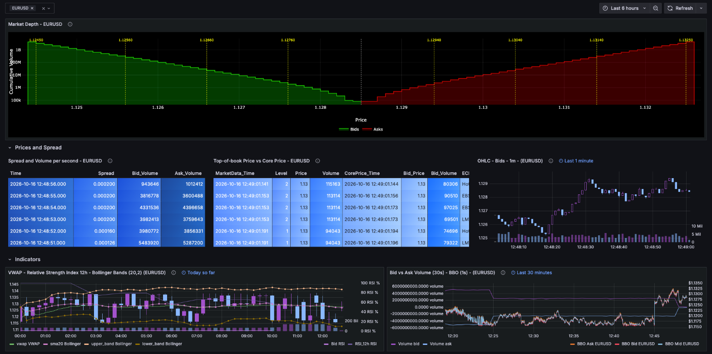
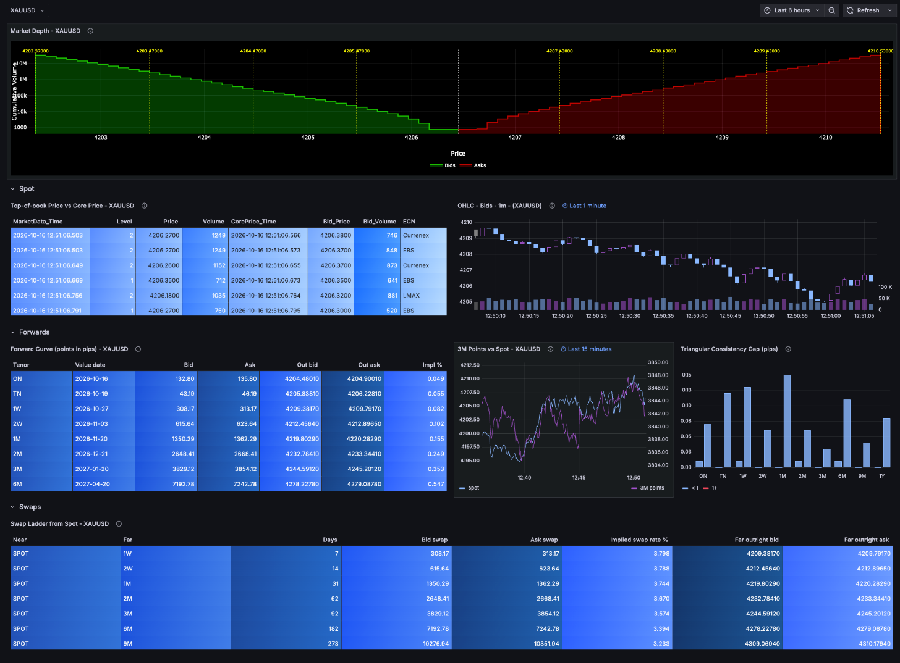

# Grafana dashboards

The two demo dashboards for Grafana. The same dashboards also exist as native QuestDB Web
Console notebooks, documented in [questdb-console-dashboards.md](questdb-console-dashboards.md).

- `grafana_dashboard.json`: FX Orderbook - Realtime Demo
- `fx_forwards_grafana_dashboard.json`: FX and Metals: Spot and Forwards

## Setup

- **Plugins:** the QuestDB datasource (`questdb-questdb-datasource`) for every panel, and the
  Plotly panel (`ae3e-plotly-panel`) for Market Depth.
- **Import:** Dashboards, New, Import, then upload the file. Both files are exported with the
  datasource as an input (`DS_QUESTDB`), so Grafana asks you to pick your QuestDB datasource.
- **Table names are fixed:** the queries use the bare names (`market_data`, `core_price`,
  `fx_forward_points` and the views). With a generator `--suffix`, edit the queries.
- **Data needed:** both dashboards read `market_data` and its views, so they do not work in
  two-table mode (`--market_data_processes 0`). The second one needs
  `--metals true --forwards true` and `fx_forward_points_1m` (`--create_views true`).

## Shared controls

### Symbol picker (`$SYMBOL`)

A query variable, shown as a dropdown at the top without a label. Its options come from

```sql
SELECT distinct SYMBOL FROM (
  SELECT SYMBOL FROM core_price
  WHERE timestamp > dateadd('d', -4, now())
  LATEST ON timestamp PARTITION BY symbol
) ORDER BY symbol;
```

so it lists every pair with `core_price` data in the last 4 days (metals included when the
generator runs with `--metals true`). The list is refreshed when the dashboard loads. Panel
queries use it as `'${SYMBOL}'`, and panel titles show it.

- **FX Orderbook - Realtime Demo:** multi-select. Market Depth and the two rows (Prices and
  Spread, Indicators) repeat per selected value: selecting EURUSD and GBPUSD puts two depth
  charts side by side, then each row once per pair.
- **FX and Metals: Spot and Forwards:** single select, XAUUSD by default.

### Time picker and per-panel windows

The dashboard range defaults to the last 6 hours, in the browser's time zone. Most panels do not
use it directly: they override it with their own relative window (Grafana's panel "Relative
time" and "Time shift"), so each panel shows a fixed short span ending now. The `Window` column
below lists them. Panels without an override use the picker range.

Queries see the effective range through the Grafana macros:

- `$__timeFilter(timestamp)`: the panel's range as a `WHERE` condition.
- `$__toTime`: the end of the range. The forward curve and swap ladder use
  `timestamp <= $__toTime` with `LATEST ON`, so they show the latest ladder at the end of the
  range.

### Refresh

250 ms by default. The refresh menu offers 100 ms up to 1 day. Grafana updates panels in place,
so the depth chart and candles move smoothly at that rate.

## Dashboard 1: FX Orderbook - Realtime Demo



| Panel | Position | Window | Logic | Display |
|---|---|---|---|---|
| Market Depth | top, full width, repeated per symbol | last 10 minutes, latest snapshot | latest `market_data` row: bid and ask prices, sizes and cumulative sizes with `array_cum_sum` | Plotly step chart, absolute price on x, cumulative size on a log y axis; bids green, asks red, a white dotted line at the mid; each side is split into 4 segments and the largest level of each is marked with a yellow dotted line and its price |
| Spread and Volume per second | row Prices and Spread, left | 1 minute ending 5 s ago | `SAMPLE BY 1s`, latest 6 seconds; spread = avg(level-1 ask - level-1 bid); bid/ask volume = level-1 price x size | table; Spread on a blue-purple gradient, volumes in shades of blue |
| Top-of-book Price vs Core Price | row Prices and Spread, middle | last 1 minute | latest 6 `core_price` ticks, each `ASOF JOIN`ed to the book; `insertion_point(bids[2], bid_volume)` finds the matching book level | table: book time, level, price and size next to core time, bid price, bid size and ECN |
| OHLC - Bids - 1m | row Prices and Spread, right | last 1 minute | 1-second candles of the level-1 bid from `market_data`, with summed level-1 bid size | candlestick plus volume |
| VWAP - Relative Strength Index 12h - Bollinger Bands (20,2) | row Indicators, left | today so far (`now/d`) | 4 queries: 15m candles from `market_data_ohlc_15m`; cumulative VWAP from `market_data_ohlc_1m`; RSI over 12 hourly bars of `bbo_1h`; Bollinger 20-period SMA +/- 2 sigma on 15m closes | candlestick; VWAP and bands on the price axis, RSI on its own axis up to 100 |
| Bid vs Ask Volume (30s) - BBO (1s) | row Indicators, right | last 30 minutes | 30 s summed level-1 bid volume, ask volume negative; bid, ask and mid from `bbo_1s` | lines; volumes and prices on separate units |

## Dashboard 2: FX and Metals: Spot and Forwards



The spot panels are copied unchanged from dashboard 1 (same queries, windows and refresh), so
spot looks and ticks the same. In the top-of-book table the fixed column widths are removed and
prices show 4 decimals, so metal prices fit.

| Panel | Position | Window | Logic | Display |
|---|---|---|---|---|
| Market Depth | top, full width | last 10 minutes, latest snapshot | as dashboard 1 | as dashboard 1 |
| Top-of-book Price vs Core Price | row Spot, left half | last 1 minute | as dashboard 1 | table, 4 decimals on prices |
| OHLC - Bids - 1m | row Spot, right half | last 1 minute | as dashboard 1 | candlestick plus volume |
| Forward Curve (points in pips) | row Forwards, left half | latest ladder at the end of the range | `DECLARE` derives the pip, display decimals, quote currency and day-count basis from `${SYMBOL}`; latest `fx_forward_points` row per tenor plus the latest `core_price` bid and ask; outright = spot +/- points x pip, with ON/TN (before spot) cumulated backwards and subtracted; implied rate from an inline quote-currency curve (USD, EUR, JPY, CHF, CAD by tenor) | table: tenor, value date, bid and ask points, outright bid and ask, `Impl %` |
| 3M Points vs Spot | row Forwards, middle | last 15 minutes | every 3M ladder in the raw table (one every 5 s): `spot_ref` and mid points | lines; spot on the left axis, 3M points on the right |
| Triangular Consistency Gap (pips) | row Forwards, right | picker range, latest complete minute | from `fx_forward_points_1m`: per tenor, how far EURJPY and XAUEUR points are from what EURUSD x USDJPY and XAUUSD / EURUSD imply, in premium terms using each row's `spot_ref`; the minute still being written is skipped. Always these five symbols, whatever `$SYMBOL` is | bar chart by tenor, EURJPY and XAUEUR series; bars turn red at 1 pip |
| Swap Ladder from Spot | row Swaps, full width | latest ladder at the end of the range | spot-to-tenor swaps for tenors after spot: swap points, implied swap rate (360 basis), far-leg outright bid and ask from the latest `core_price` | table |

To show the planted bad point (XAUEUR 3M, or EURJPY 3M without metals, 09:20 to 09:40 UTC
daily), set the time picker to a range that ends inside that window. The consistency panel then
reads a minute from it and the bar turns red. The curve and swap ladder follow the same end
time.

## Differences from the QuestDB Web Console notebooks

- **Symbol and time:** Grafana uses the `$SYMBOL` dropdown and the time picker; the notebooks
  use the `@symbol`, `@asof` and `@from` variables.
- **Multiple symbols:** only dashboard 1 in Grafana can show several pairs at once (repeated
  rows).
- **Depth chart:** Grafana plots absolute prices with the largest levels marked; the notebooks
  plot pips from the mid.
- **Spread and Volume:** not in the Grafana forwards dashboard; the notebook adds it.
- **Formatting:** Grafana sets decimals and colours per column in panel options; the notebooks
  format in SQL.
